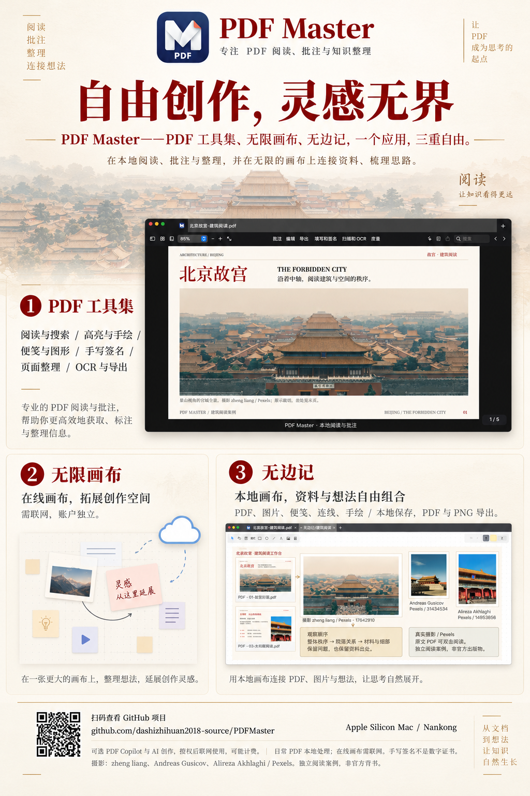

# PDF Master

> **© 2026 Nankong 版权所有。仅供非商业技术交流；未经书面许可，不得将 Nankong 未另行授权的原创内容用于商业用途。** 第三方内容权利归原权利人所有。详见 [版权与使用条件](COPYRIGHT.md)。

**自由创作，灵感无界。**

V0.1.21 / build43：批注列表改为紧凑的 44/60 点条目，显示修改日期与时分，修正编辑后时间不更新的问题。旧批注没有时间时不补造日期。[本版范围与验证](docs/ANNOTATION-SIDEBAR-V0.1.21.md)。微信图片/附件粘贴是独立未完成项。

[官方下载官网](https://dashizhihuan2018-source.github.io/PDFMaster/) · [逐项功能](https://dashizhihuan2018-source.github.io/PDFMaster/features.html) · [使用教程](https://dashizhihuan2018-source.github.io/PDFMaster/guide.html) · [安装包与版本说明](https://github.com/dashizhihuan2018-source/PDFMaster/releases/tag/v0.1.21)

2026-10-26 **V0.1.21 / build43**：内容编辑与字体兼容迁移为独立 Swift / Apple 系统框架实现，必要 qpdf 随 App 打包，不再要求用户安装 Python、PyMuPDF、fontTools 或 Homebrew。复杂 PDF 保守拒绝，不承诺任意格式或所有 Mac 兼容。历史 [V0.1.19 源码修订 r1](https://github.com/dashizhihuan2018-source/PDFMaster/releases/tag/v0.1.19-r1) 保留，不覆盖旧资产。

PDF Master 是面向 macOS 的 PDF 阅读与知识整理工作台。以 **PDF 工具集、无限画布、无边记** 三种工作方式，将文档、图片、便签与想法连接起来：从专注阅读，到自由批注，再到有序整理，让 PDF 成为思考的起点。

[30 秒产品介绍](#30-秒了解-pdf-master) · [高清海报](#产品海报) · [编译与使用](#编译与打包)

## 一个应用，三重自由

| 工作方式 | 帮你完成什么 | 使用方式 |
| --- | --- | --- |
| **PDF 工具集** | 阅读与搜索、高亮与手绘、便签与图形、手写签名、页面整理，以及有限结构内容编辑、OCR 与导出操作 | 本地工具随包提供，支持边界详见功能页；AI 单独配置 |
| **无限画布** | 在软件内置的节点工作区组合文字、图片、视频与想法 | 离线编辑、本机保存；AI 生成使用自己的 DMX Key 并联网计费，无网站登录或跳转 |
| **无边记** | 在本地画布中自由组织 PDF、图片、便签、连线与手绘，保存为 `.pdfmasterboard`，并导出 PDF 或 PNG | 本地保存，与内置 AI 节点画布分别管理 |

### 产品海报

<p align="center">
  <a href="docs/media/pdfmaster-poster.png"></a>
</p>

### 30 秒了解 PDF Master

https://github.com/user-attachments/assets/aa9354ed-a69b-4c0f-857b-c7813d62ea3f

从阅读与批注，到在线创作与本地整理，快速了解三种工作方式。视频约 30 秒，保留原画面与声音，可直接在本页播放；[下载 MP4](docs/media/pdfmaster-demo.mp4)。

海报与视频为产品展示，具体功能及兼容范围以当前源码和[兼容性与验证说明](VERIFICATION.md)为准。手写签名不是数字证书；可选 PDF Copilot 与 AI 创作需授权联网使用，可能产生第三方费用。摄影署名与媒体说明见[展示素材说明](docs/media/README.md)。

## 获取与使用

当前 macOS 安装包 **V0.1.21**（build43）。[下载 macOS Apple Silicon 安装包](https://github.com/dashizhihuan2018-source/PDFMaster/releases/download/v0.1.21/PDFMaster-V0.1.21-arm64.dmg) · [发布说明与 SHA-256 校验文件](https://github.com/dashizhihuan2018-source/PDFMaster/releases/tag/v0.1.21)。更新前保存文档并正常退出旧版。此包包含 qpdf 本地引擎，仍为 ad-hoc 签名、未获 Apple 公证的预发布；最低构建目标 macOS 14.0，尚未完成其他 Mac 或所有系统版本验收。系统安全检查未通过时停止并反馈，不关闭全局安全保护。Windows 仍为旧独立预览。非商业技术交流、隐私及第三方权利说明见[使用与权利声明](DISCLAIMER.md)。本项目与 Apple、Readdle 等第三方不存在合作或官方背书关系。

V0.1.19 修复导入图章（Stamp）中整张CAD图纸被低分辨率缓存放大而发糊的问题，按当前缩放与Retina像素密度重绘原始外观，保留批注叠放与旋转，不压平或改写原PDF。本机完整778项测试通过，并检查原生窗口多倍率及滚动显示；不是所有PDF或其它Mac的兼容认证。详见[发布说明](https://github.com/dashizhihuan2018-source/PDFMaster/releases/tag/v0.1.19)。

V0.1.18 更新原生阅读器右侧 PDF Copilot、富文本回答及页码引用，支持在本机账户设置中分别绑定自己的 **DMX / DeepSeek / Agnes Key**，并包含 build40 的双页布局、字体兼容与批注修复。不同账户/服务商不共用 Key，发送前需核对范围并同意可能计费；DeepSeek 真实 Key 调用尚未验证。包内不包含用户登录状态、真实密钥或用户文档。

**当前版本对应项目源码：V0.1.21/build43。** 本仓库包含 Swift 原生程序、画布前端、测试、资源、许可证和构建脚本。公开包沿用已审查的画布前端，其源码在 `CanvasWeb/`，不含私有演示、第三方提示词快照或用户数据。主程序由此公开源码树构建，清除本机构建路径并使用 macOS 14 兼容 qpdf 后重新签名；不承诺自行构建结果逐字节一致。开发构建需准备下述工具，最终 App 不需要开发环境。依赖缓存、编译产物和私人开发历史不属于项目源码。

V0.1.7 将无限画布随应用打包，从固定本地源加载，不再加载或跳转画布网站。无需网站或本机账户登录，点击“DMX Key 设置…”输入自己的 Key，Key 仅在本机钥匙串保存，不交给 JS、配置 JSON 或画布 ZIP。首次生成需原生会话授权；费用由自己的 DMX 账户承担。[完整使用教程](docs/无限画布使用教程.md)。支持页仅保留邮箱 `archseuyang@163.com`。同时保留关闭窗口后再次打开 PDF / Dock 重开时的窗口生命周期修复。

视频支持 Seedance 2.5 文字或单首帧，不含多参考图、尾帧、参考视频/音频托管。独立网站服务端 Agent、云同步、外部渠道与远程插件安装未打包。未使用真实 Key 做付费生成验收。公开树不附画布上游项目演示图片/视频或第三方提示词快照，保留仓库既有产品宣传素材；用户可以自行导入有权使用的素材。

V0.1.5 简化“文件 → 压缩文件大小…”：紧凑面板用一行原生控件选择 72、150 或 300 DPI，显示真实大小与减少比例，支持无损优化和另存副本。修复长文档分析预算过早耗尽、导致各档均退回无损优化的问题。按图片在页面上的实际使用尺寸降采样，不将整页转成图片，保留文字、矢量、链接与批注结构。复杂色彩、遮罩及无法可靠判断的图片保守跳过；不承诺固定缩小比例，不覆盖原件，无收益不生成副本，签名与加密来源不执行压缩。已实测原生面板切换质量和保存压缩副本；应用运行中默认打开的用户故障报告尚未闭环，见验证说明。

V0.1.3 补齐外部打开入口的 URL、批量文件与启动排队处理。

V0.1.2 支持先选高亮、下划线或删除线，再拖选文字，松开即标记，工具保持选中以便连续操作；也支持先选文字再点工具。按 Esc 或再次点击当前工具退出标记模式后，可选中批注按 Delete 删除，或使用左侧批注列表的垃圾桶按钮。支持 ⌘Z 撤销、⇧⌘Z 重做，修改后按 ⌘S 保存。

V0.1.0 完善文档保存体验：⌘S 直接保存当前 PDF，新文档首次保存后记住位置；⌘⇧S“另存为”切换到新文件，“存储副本”保留独立导出。检测到外部文件修改时停止覆盖，保留当前更改；保存后撤销仍有未保存提醒。编辑重要原件前请先备份。

本地「无边记」与联网「无限画布」分别放入侧栏，支持新建、打开及返回已打开的本地画布，兼容已有 `.pdfmasterboard` 文件与存档标题；同时完善页面与批注的复制、剪切、粘贴及常用工具快捷键，文字输入保留原生编辑行为。验证范围与待验证操作详见验证说明。

## 功能与限制

**独立环境检查（2026-10-26）：** 原样公开 DMG 已在两台 GitHub 标准 Apple 芯片虚拟机（macOS 14.8.9、15.7.9）通过下载哈希、签名、包内 qpdf、自建 PDF、应用启动后持续运行及正常退出检查。没有修改安全设置、重建或重签软件。curl 下载不等于浏览器首次安全确认，绿色 CI 不等于 Apple 公证或逐功能 GUI 验收。见[实际范围与日志](docs/CI-release42.md)及[首次安装说明](https://dashizhihuan2018-source.github.io/PDFMaster/guide.html#install)。

支持基础阅读、搜索/大纲/缩略图、批注与手绘/签名、基本页面操作、图片与文字类文件导入、PNG/JPEG 导出，以及自包含 `.pdfmasterboard` 本地画布。复杂 PDF、表单、加密/签名与主动内容有保守拒绝边界。内容编辑、OCR 与格式转换只覆盖明确子集，不承诺任意 Office 原版式转换、完整 OCR 互操作或全功能兼容。请使用自有测试副本并存储副本后独立核对。

无边记的 `.pdfmasterboard` 与内置无限画布的 ZIP 是两种不同格式，不自动互转；原网站项目也不会自动迁移。内置画布离线编辑不代表 AI 模型生成可离线运行。

## 编译与打包

需要 macOS 14+、支持 Swift tools 6 的 Xcode/Command Line Tools，以及 Node.js 22.12+ / npm。内部 Swift target 名保留 PaperDesk/PaperCore。先构建画布资源，再运行原生测试：

```sh
(cd CanvasWeb && npm ci --ignore-scripts && npm run typecheck && npm run build)
# 先按下方说明从官方源码构建 qpdf，再把显式路径传入测试和打包。
PDFMASTER_TEST_QPDF="$PWD/work/vendor-build/bin/qpdf" \
PDFMASTER_QPDF="$PWD/work/vendor-build/bin/qpdf" swift test
```

打包结果为 `dist/PDF Master.app`。脚本从锁文件安装前端依赖、构建本地画布与原生程序并创建新 bundle，不安装、不运行、不清理旧版本；已有目标会拒绝覆盖。使用 macOS 本地 ad-hoc 签名，不改变系统安全策略。

### 构建并捆绑 qpdf

从 [qpdf 12.4.2 官方发布](https://github.com/qpdf/qpdf/releases/tag/v12.4.2)和 [libjpeg-turbo 3.2.0 官方发布](https://github.com/libjpeg-turbo/libjpeg-turbo/releases/tag/3.2.0)取得源码，核对厂商校验/签名并解压。需要 CMake；脚本不自动下载、不安装到系统。`QPDF_SOURCE`、`JPEG_SOURCE` 在下例中由你设为已核对源码的绝对目录。

```sh
bash scripts/build-qpdf.sh --qpdf-source "$QPDF_SOURCE" \
  --jpeg-source "$JPEG_SOURCE" --output "$PWD/work/vendor-build"
export PDFMASTER_TEST_QPDF="$PWD/work/vendor-build/bin/qpdf"
export PDFMASTER_TEST_QPDF_LIB="$PWD/work/vendor-build/lib/libqpdf.30.dylib"
export PDFMASTER_TEST_QPDF_SOURCE="$QPDF_SOURCE"
export PDFMASTER_TEST_JPEG_SOURCE="$JPEG_SOURCE"
export PDFMASTER_QPDF="$PDFMASTER_TEST_QPDF"
swift test
bash scripts/build-app.sh --qpdf "$PDFMASTER_TEST_QPDF" \
  --qpdf-lib "$PDFMASTER_TEST_QPDF_LIB" \
  --qpdf-source "$QPDF_SOURCE" --jpeg-source "$JPEG_SOURCE"
```

脚本捆绑 qpdf、依赖库及对应许可证，检查依赖闭包与最低系统目标。生产原生内容引擎仅使用包内组件；DEBUG 测试允许上述显式工具注入。不要提交 `work/vendor-build` 或源码缓存到 Git。

### 测试样本与原生引擎

内容编辑和字体兼容使用 Swift、CoreText、PDFKit 与包内 qpdf，不含旧 Python 编辑脚本。测试现场生成虚构文字、四色图和矢量 PDF，不需用户 PDF 或私人工作目录。原生单行编辑、图像替换、链接与有限区域移除均有保守拒绝边界，不是完整桌面排版器或认证脱敏方案。故障文件清晰度测试仍是单独 opt-in，仓库不附用户文件，默认跳过该项，其余项目使用合成 Stamp。开发环境中的 `scripts/audit-source.py` 只是源码审查工具，不是 App 运行时。

## 网络、账户和隐私

AI 功能使用用户自行提供的 DMX Key；Key 置于本机非同步 Keychain，仓库不含可用 API Key。生成需明确勾选同意，可能计费。图片/视频发送输入提示词；PDF Copilot 发送选定范围的可复制文字（默认当前页、有长度上限），不是 PDF 二进制或页面图片。回答未经核实；停止本机请求不能撤回已发送内容，也不保证停止远端计费。

复制页面与批注使用 macOS 系统剪贴板，页面另提供 PDF 类型以便其他应用使用；剪贴板不是应用私密存储，请勿将敏感内容留在共享剪贴板或提交到问题反馈中。

应用保留一个有意公开的默认本机账户/口令。**它不是秘密，也不是安全隔离；首次登录后立即修改。** 本机账户不是操作系统账户、云身份或 AI 长期记忆，同一 macOS 用户下的进程不因此隔离。公开源码将公开这个默认值；不要把真实凭据、用户偏好、最近文档或 Keychain 导出提交到仓库。

## 源码与素材许可状态

此源码目前仅公开供查看；权利人尚未指定项目开源许可证，因此不应推定获得使用、修改、复制或再分发授权。此声明不改变第三方组件各自已授予的许可，也不声称拥有第三方或生成内容的排他权利。请先取得权利人明确授权再作其他用途。

SwiftyDraw 局部平滑路径适配保留 MIT 许可证与固定来源说明，见 `Resources/Licenses/SwiftyDraw/`。品牌与 56 张工具图标的来源说明见 `Resources/ASSETS.md`。系统框架/字体不随仓库复制。qpdf 与 libjpeg-turbo 源码未捆绑在此仓库；发布 App 内含其二进制和完整许可，已移除 PyMuPDF 运行时。若另行分发第三方源码或二进制，请遵守各自许可证并保留完整 notice，不能拿 SwiftyDraw MIT 作为整个产品许可。

内置画布前端基于 basketikun 的 InfiniteCanvas（MIT）改编，许可证和改编说明见 `CanvasWeb/LICENSE` 与 `Resources/Licenses/InfiniteCanvas/`。该部分不受本项目原创内容的额外非商业限制；npm 依赖各自遵循其许可证。

© 2026 Nankong 版权所有。原创部分仅供非商业技术交流，未经书面许可不得商用；已有许可与第三方权利不变。

## 持续更新

源码、交互体验与使用文档持续维护，以当前默认分支及实际验证范围为准。反馈 PDF 兼容性问题时，请使用人工生成的最小示例，勿上传私人文档、签名、截图中的个人资料或账号信息。
