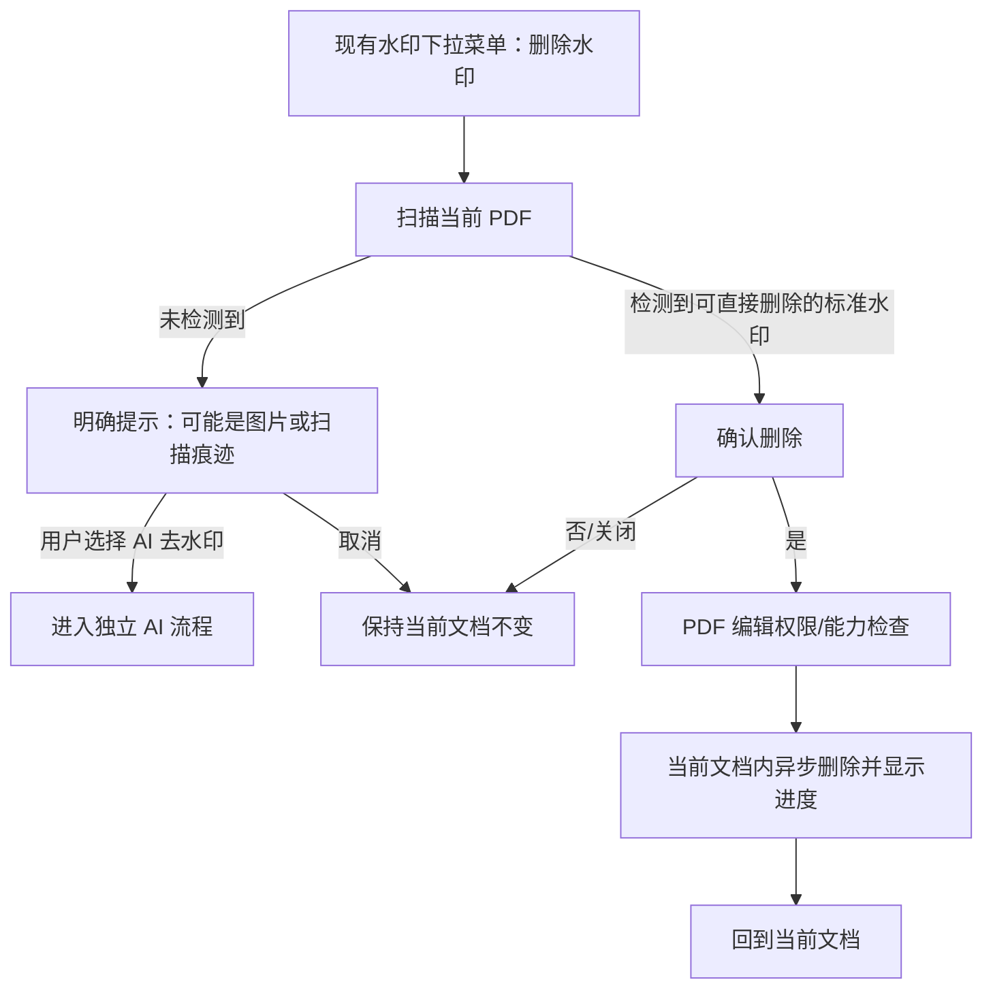

# WPS PDF 普通“删除水印”交互静态研究

日期：2026-11-07

目标：本机 `/Applications/wpsoffice.app`，版本 `12.1.29182`（build 29182）

范围：只读静态分析普通 `KxUfdDeleteWaterMarkCommand`；不复述批量去水印反编译，不绕过授权，不注入进程，不处理用户私有文档。
结论等级：**静态证据已成立；尚未完成实时 UI / 人工视觉验收。**

## 结论摘要

WPS 的普通“删除水印”不是批处理导出页，也不是独立工具卡。多个入口最终汇入同一个 `KxUfdDeleteWaterMarkCommand`：它针对当前 PDF 文档先扫描可直接删除的标准水印，必要时显示进度；找到后要求确认，并经过 PDF 编辑权限/付费能力检查，再在当前文档中异步执行删除。未找到标准水印时，它不会悄悄导出新文件，而是提示当前对象可能是图片或扫描痕迹，并可引导到独立的 AI 去水印流程。

这支持 PDF Master 采用“当前文档、原位置入口、确认后原位处理”的交互，而不支持新增卡片、页码范围、预览网格或“另存为”作为普通去水印的主流程。

## 已观察到的静态事实

### 1. 普通命令覆盖多个既有入口

- `ufdcommon.kuip` 中，普通删除命令与批量、AI 命令是并列的不同命令：普通命令类名为 `KxUfdDeleteWaterMarkCommand`，命令 ID 包括 `TabEdit_DeleteWatermark`；同一资源还把普通删除放在插入、水印下拉菜单及阅读模式入口。
- `commands/ufd/ongmani/CT_Protect.kuip` 和 `commands/ufd/PopupMenu.kuip` 还提供保护页、工具菜单及插入内容右键入口。
- 反编译出的普通命令分发函数读取命令对象的 `id` 属性，把 `TabInsert_DeleteWatermark`、`TabProtect_DeleteWatermark`、`TabEdit_DeleteWatermark`、`TabPage_DeleteWatermark`、`ToolMenu_DeleteWatermark`、`InsertContent_DeleteWatermark` 和阅读模式入口映射为来源标签，然后进入同一个当前文档扫描路径。

证据：E-ORD-001、E-ORD-004。

### 2. 先扫描当前文档，再决定确认或引导

- 分发函数从当前 PDF 文档接口取对象，启动普通水印扫描，并创建名为 `KxUfdDeleteWaterMarkCommand_spProgressWidget` 的进度控件；`QTimer` 周期/延迟参数为 500 ms。
- 扫描回调停止定时器、释放进度控件并读取异步结果。
- 未找到可直接删除的水印时，存在两种静态可见提示路径：较早/简单提示说明文件中没有可删除的标准格式水印；较新的引导对话框明确说明未检测到可直接删除的水印，并提示可见痕迹可能是图片或扫描痕迹，可尝试 AI 去水印。
- 新引导对话框具有“转到 AI 去水印”和“取消”两种遥测分支；AI 是独立后续入口，不是普通删除命令内部的同一种算法。

证据：E-ORD-003、E-ORD-005、E-ORD-006。

#### zh_CN 精确文案映射

对本机 Qt 5.12 QM 文件做格式感知解析后，普通命令相关英文源文案可精确映射为以下中文。这里的偏移是 `pdf.qm` 内对应消息记录的起始偏移，不是凭 `strings` 猜测的相邻文本：

| 交互位置 | 英文 source | Qt 类上下文 / 消歧键 | `pdf.qm` hash / 消息偏移 | zh_CN 译文 |
|---|---|---|---|---|
| 发现可删除水印后的确认正文 | `Make sure to delete the existing watermark` | `KxUfdDeleteWaterMarkCommand` | `0x032e0484` / `0x11324` | `确定要删除已有水印吗？` |
| 确认按钮 | `Yes` | `KxUfdDeleteWaterMarkCommand` | `0x076f4ee4` / `0x18e34` | `确定(F)` |
| 取消按钮 | `No` | `KxUfdDeleteWaterMarkCommand` | `0x03488ee4` / `0x11562` | `取消(C)` |
| 旧式“无可删除水印”提示 | `Cannot find waterMark that can be removed in the file.If you can see the watermark, it cannot be deleted because it is not a standard watermark format.` | `KxUfdDeleteWaterMarkCommand` | `0x0c46d474` / `0x21292` | `无法找到文件中可删除的水印。若能看到水印，因其并非标准水印格式，所以不能删除。` |
| 新式引导第一行 | `No watermark that can be deleted directly was detected.` | `KxUfdScanNoWaterMarkGuideDlg` | `0x03c3f537` / `0x12480` | `未检测到可直接删除的水印。` |
| 新式引导第二行 | `If a watermark is still visible on the page, it may be an image or scan mark. Try AI watermark removal.` | `KxUfdScanNoWaterMarkGuideDlg` | `0x0290a7b7` / `0x10038` | `若页面上仍能看到水印，可能是图片或扫描痕迹，可尝试 AI 去水印处理。` |
| 新式引导 AI 按钮 | `AI Remove Watermark` | `KxUfdScanNoWaterMarkGuideDlg` | `0x0e919e87` / `0x25322` | `AI 去水印` |
| 新式引导取消按钮 | `Cancel` | `KxUfdScanNoWaterMarkGuideDlg` | `0x0ed3bde7` / `0x259fe` | `取消` |

来源文件：`/Applications/wpsoffice.app/Contents/Resources/office6/mui/zh_CN/pdf.qm`，SHA-256 `9658e78de50549ff96d4be4e3eb4dc94a2839926ca56c9679d05751144f82e9f`。同目录 `ufdsecurity.qm`（SHA-256 `38d9fed2981199bc32434c8a776fcc6f13b964b1c3e4e28431a29b9f0cf12a7d`）和 `ufdcontentedit.qm`（SHA-256 `8349e29ce6713de88c9b052f087932e4c9dbc1cc2f49158a4d92524300056542`）中，没有命中上述 source + 类键组合；这是限定于这组已知普通链源文案的否定结果。

解析方法：校验 QM magic `3cb86418caef9c95cd211cbf60a1bddd`，读取 `Hashes` (`0x42`)、`Messages` (`0x69`) 和 `Contexts` (`0x2f`) 区块；按 [Qt 5.12 `QTranslator` 官方实现](https://code.qt.io/cgit/qt/qtbase.git/plain/src/corelib/kernel/qtranslator.cpp?h=5.12)的 ELF hash 规则匹配 source 与消歧键，再从 UTF-16BE `Tag_Translation` (`0x03`) 读取译文。上下文表同时包含 `KxUfdDeleteWaterMarkCommand` 与 `KxUfdScanNoWaterMarkGuideDlg`。未安装新工具，也未生成或复制 QM 资产。证据：E-ORD-011。

### 3. 检测到水印后有确认和权限门槛

- 确认/权限函数包含“确认删除现有水印”语义及 Yes / No 分支，并分别记录确认、否定和关闭行为。
- 同一函数检查 `PDFCheckPrivilege`、`pdf_edit`，以及 PDF 删除水印的能力/商品标识；登录、权限提示和取消均有独立回调。
- 权限准备完成后才进入实际删除函数。该结论描述产品控制流，不代表也不建议绕过任何授权检查。

证据：E-ORD-007、E-ORD-009。

### 4. 实际删除在当前文档中异步执行

- 删除启动函数重新取得当前 PDF 文档，清理旧的权限请求对象，创建删除操作对象，把它交给文档/当前操作接口，并再次建立进度控件和 500 ms 定时器。
- 在已跟踪的普通调用链中，没有观察到输出目录、目标文件名、页码范围或预览页参数；这些是之前识别出的批量流程特征，不是这里的普通命令特征。
- 因此，“普通删除作用于当前内存文档”是强证据支持的解释；“完成后是否自动保存到磁盘”则没有静态证据支持。

证据：E-ORD-004、E-ORD-008、E-ORD-010。

## 对 PDF Master 的兼容交互约束

以下是基于上述证据的产品解释，不是复制 WPS 代码或资源：

1. 入口应留在当前 PDF 的既有“水印”下拉菜单，动词使用“删除水印”；不新增首页卡片、工作台或批量工具面板。
2. 点击后直接扫描当前文档。快速扫描不应制造额外页面；超过短时阈值时才展示轻量进度。静态证据确认了 500 ms 定时器，但无法仅凭静态代码断言它必然是“防闪烁延迟”，实现应以实际体验为准。
3. 找到可删除水印后先确认。普通路径不应要求页码范围、预览网格或输出目录。
4. 确认后在当前文档内执行异步删除，完成后仍停留在原文档和原窗口。文档应按 PDF Master 自身正常编辑语义标记为已修改。
5. 未找到标准水印时要明确解释“可能是图片/扫描痕迹”，保持文档不变；若 PDF Master 尚无成熟 AI 去水印，不应伪造可用入口。
6. 保存和撤销只能沿用 PDF Master 已验证的文档编辑机制。WPS 静态链未证明自动保存或可撤销，因此不能为了“像 WPS”而新增未经验证的自动保存或承诺撤销。

## 证据台账

| Evidence ID | 类型 | 位置 / REA 证据 | 支持的事实 |
|---|---|---|---|
| E-ORD-001 | 本机资源 | `/Applications/wpsoffice.app/Contents/Resources/office6/res/ufdcommon.kuip:862-868,998-1000,1091-1093`；`commands/ufd/ongmani/CT_Protect.kuip:8`；`commands/ufd/PopupMenu.kuip:320,323` | 普通、批量、AI 是不同命令；普通命令出现在多个既有入口。 |
| E-ORD-002 | 目标身份 | `ufdmain` universal SHA-256 `5d9b5916f77bd8e836dad9cfd285b4ba2906ba788abf794166e1fb8a8033bb0b`；签名标识 `cn.wps.framework.ufdmain`，Team `YK4WKE5WAM` | 分析对象身份与完整性。 |
| E-ORD-003 | REA 字符串 | `ev_fc237f1a1f16c8be3d949bef3313d18f6ee71268f49adeba4c0feea872c72dca` | 普通命令 RTTI、工厂项、进度控件和无标准水印引导对话框标识。 |
| E-ORD-004 | REA 反编译 | `0x38efac`，`ev_1a42d37680d3ea27706114f80389eed5de57f9c4c6f7bb3545ee9d73f636a705`；进度初始化 `0x38a33c`，`ev_5bd7906146300400363605f2df71fef4f07febe0867ea531e4ff48d81a9c8fc6` | 多入口汇入同一普通处理器；从当前文档启动扫描；进度控件和 500 ms 定时器。 |
| E-ORD-005 | REA 反编译 | 扫描结果回调 `0x38c470`，`ev_7839e620c9581ed130c6395606f0e38b428c0f6a46436a5a5af68c4fa6d8a4b1` | 停止进度、区分“存在/不存在可删除水印”，然后进入提示或确认。 |
| E-ORD-006 | REA 反编译 | 无标准水印引导 `0x38e7e8`，`ev_66bfa38e1a4e899ae89dde5ed3a589222781f15588d4cb9859e9f50a74b04e5b` | 图片/扫描痕迹解释，以及 AI 去水印或取消分支。 |
| E-ORD-007 | REA 反编译 | 确认/权限 `0x38d0d0`，`ev_eef2b8a7b1d716b032328f84852b221b14f8255d64db3b2aa4fff733a15b98ba` | 删除前确认；PDF 编辑权限、登录/能力门槛。 |
| E-ORD-008 | REA 反编译 | 删除启动 `0x38eb28`，`ev_c45e809d9b4b603eb965578cb4ff5e14b731c857c44a7bb72bc0beeafa85c744` | 当前文档操作对象、异步删除、进度控件。 |
| E-ORD-009 | REA 反编译 | 权限回调 `0x38ea9c`，`ev_4b4fc41e3f729cafc4f83aeda15d293c5e5cce9c873fbcff4da6311b98d9669f` | 权限就绪后才进入删除启动函数。 |
| E-ORD-010 | 有界否定搜索 | 对 `ufdmain` 普通命令相邻字符串与上述调用链检查 | 未在已跟踪普通链中发现页码范围、预览、输出路径、自动保存、成功提示或撤销承诺；这是有界否定结果，不等于整个 WPS 中绝对不存在。 |
| E-ORD-011 | Qt QM 格式解析 | `zh_CN/pdf.qm`，Hashes / Messages / Contexts 区块及上表 hash、消息偏移；`ufdsecurity.qm`、`ufdcontentedit.qm` 作为有界对照 | 精确 source/context-key → zh_CN 映射；确认按钮实际为“确定(F)”和“取消(C)”。 |

分析使用的 arm64 薄片仅保留于本机私有 REA 个案证据目录，未包含在公开源码或安装包中，SHA-256 `accb10872a5b8a4e946a558d53f4dda93c1e562593a11d71cb93128a969855a1`。原始签名二进制未修改。

## 已观察、推断与未知

### 已观察

- 普通命令跨多个 UI 入口复用同一处理链；批量和 AI 命令是独立命令。
- 普通路径针对当前文档扫描，未检测到时提示，检测到后确认、权限检查、异步删除并显示进度。
- 本机 `zh_CN/pdf.qm` 已静态证实上述八条普通删除相关中文映射，包括“确定(F)”“取消(C)”和无标准水印引导；这仍不证明控件在当前账户/运行状态下一定可见。
- 已跟踪普通路径中没有批量流程的页码范围、预览或输出目标。

### 基于证据的推断

- 删除结果首先改变当前内存文档，用户随后通过正常文档保存机制持久化；前半句证据强，后半句是基于“未见输出/保存调用”的交互推断。
- 500 ms 定时器可能用于延后进度展示或轮询任务，以避免快速任务闪烁；具体用途需运行时验证。
- PDF Master 若要复现“无缝”感，应在当前文档原位执行并沿用现有脏状态/保存流程，而不是创建导出任务卡。

### 仍未知，需安全的实时验证

- 删除完成后 WPS 是否自动标记文档为脏、是否自动保存，及关闭时的保存提示。
- 普通删除是否注册到撤销栈，Cmd-Z 是否恢复；静态调用链没有足够证据。
- 成功时是否显示 toast、状态栏文字或其它完成提示。
- 500 ms 定时器的精确显示条件，以及极快/极慢文档的实际进度行为。
- 哪些 PDF 内部结构会被认定为“标准/可直接删除”水印。
- 不同账号与许可证状态下，确认框与权限门槛是否完全一致。
- 本机中文界面的控件布局、可见条件与人工视觉体验；文案资源映射已证实，但尚未 live 呈现确认。

## 边界与限制

- 本报告只证明 WPS 12.1.29182 本机二进制和资源中存在的静态控制流，不等于 live UX 已通过，也不证明其他版本行为一致。
- 没有打开或解析用户私有 PDF，没有控制 WPS UI，没有进行进程注入、动态 hook、授权绕过或联网取证。
- 只记录行为语义和证据定位；没有把 WPS 代码、图标、布局资产或私有实现复制进 PDF Master。
- 实时确认应由父任务在安全合成 PDF 上完成，并分别验证：无匹配、确认取消、确认删除、保存提示、Cmd-Z 和关闭文档行为。
