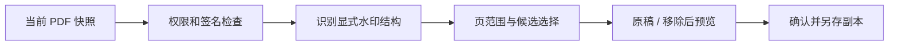

# 本机 WPS 去水印 REA 研究（只读）

日期：2026-11-07。用户明确指定使用 REA 研究本机 WPS，不是名为 REAWPS 的独立项目。此报告为独立功能设计依据；不包含 WPS 实现代码、反编译表达、资产或二进制。

修订：本报告主要分析**批量模块**，下述旧交互契约已被用户纠正并废止，不能作为普通去水印交互依据。普通命令的后续证据及当前合同见 [普通删除水印研究](2026-11-07-wps-ordinary-watermark-interaction.md)。产品不再采用这里的卡片/页范围/双预览/另存面板。

## 目标身份与边界

WPS 12.1.29182/build29182，Apple Mac OS Application Signing，Team YK4WKE5WAM，hardened runtime 标志存在。只分析安装包和自建文档；不修改 WPS、不绕过会员/许可、不联网调用其服务。批量模块 kbatchwatermark 原始 universal SHA256 `43782234373b64c87be5cc7818e16294abb2bf6aecbebf2601c96ed7737454d3`；临时 arm64 派生切片 SHA256 `5c54684ea9a4ac6463f4aac18a25bfebe5bf826ae43a9fdc9379f776e2cc4d14`。原包未写入。

## 观察与证据链

1. 本机 `ufdcommon.kuip` 862–879 行定义普通删除、AI 去水印、批量增删三个不同入口：`KxUfdDeleteWaterMarkCommand`、`KxUfdAIRemoveWaterMarkCommand`、`kbatchwatermark`。菜单存在不等于算法已验证。
2. REA/Ghidra12.1.4，arm64 默认自动分析完成。初次 universal 导入因 provider 无法强制切片失败；改为 `lipo -thin arm64` 的派生文件后成功，无工具或安全配置变更。
3. REA `trace_feature(PdfRemoveWatermark)`：字符串 `0x98fb1`；引用 `0x199b0`，所属 `0x1998c`。对该函数的语义检查观察到任务类型为 PDF 移除水印、遇签名失败选项启用。证据 `ev_2e9553ecf85a2bf561c06e6bbb9c756faaa05f0ba56039a4ea9255885a54f083`、`ev_0155e6deb1415f2ab3863b095736b957a366c103352045a90904609c283b594b`。
4. REA `trace_feature(PageRange)`：字符串 `0x98fda`；引用 `0x19d54/0x19e34/0x19e74`，所属 `0x19b10`。语义检查可见 Input、Output、Password、PageRange 的任务参数组装，以及首页、末页、自定义范围分支。证据 `ev_d63ef27e2bebcdba6f37f492fbfbc845f646503793572418a8ba07d7d61f84dc`、`ev_5b8492aab0f8c7be6b6475e1dc4836ce12ba358beede50fca04102bfe2c52af5`。
5. 结构化字符串观察：`0x98cc0` 另存选择控件，`0x99d3e` 效果预览，`0x99d83–0x99e56` 预览翻页/页号，`0x9a9f7` 指定范围，`0x99c16` 加密无水印权限提示。类型线索有 text/image，但其中包含添加功能，不能直接推断删除能处理所有图片。

## 旧独立实现契约（已废止，仅保留研究沿革）

- 保留预览、范围、另存及签名保护的行为意图，采用 PDF Master 自己的 AppKit/PDFKit/qpdf 组件独立实现，不复刻 WPS 商标外观。
- 优先支持显式 `/Watermark` 批注与安全可定位的标准 `/Artifact` 水印标记；未知普通文字/图片不凭颜色、透明度、重复性自动删。
- 拒绝签名/加密/主动内容及不支持结构；扫描图里烘焙的水印、WPS AI 服务和多文件批处理不在本次已批准基础功能内。

## 覆盖与未知

已获得：本机安装身份、菜单资源、REA 地址/交叉引用、两个任务参数函数语义、预览/页范围/另存字符串。未获得：普通删除引擎完整算法、AI 算法或服务、运行时真实去除效果、WPS 人工交互验收。此静态研究不能称 WPS 全功能复刻或算法等价。

私有原始证据由本机 REA case 保存，未纳入公开产品树；分析会话已关闭，无 WPS 进程注入或 patch。
